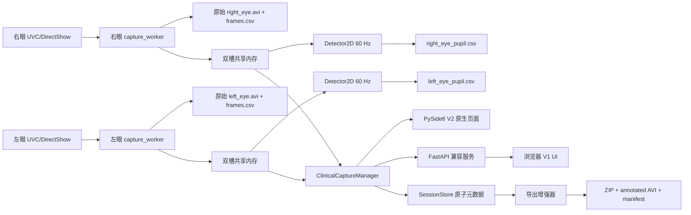

# 软件架构

## 数据流

## 模块边界

| 模块 | 责任 | 不负责 |
| --- | --- | --- |
| `models.py` | 校验相机、会话元数据、配置和状态枚举 | 不打开设备、不写文件 |
| `worker.py` | 独占一个相机句柄；归一化方向、时间戳、写 AVI/frames CSV、对连续空帧执行有界重连、上报质量状态 | 不运行瞳孔算法、不依赖浏览器 |
| `shared_frame.py` | 两槽共享内存，发布最新帧并避免读写撕裂 | 不排队全部历史帧 |
| `pupil.py` | 限速消费最新帧，调用 `Detector2D`，输出状态/CSV/预览叠加 | 不影响原始写盘 |
| `manager.py` | 生命周期、预检、开始/结束会话、故障收口和重启 | 不直接绘制页面 |
| `storage.py` | 会话目录、原子 JSON/CSV、质量汇总、ZIP | 不改变原始视频 |
| `exporter.py` | 生成标注复核视频和 SHA-256 manifest | 不把标注覆盖到原始 AVI |
| `server.py` | FastAPI 路由、输入校验、静态 UI 挂载 | 不暴露远程网络服务 |
| `ui/` | 医生端流程、设备映射、质量显示和导出操作 | 不自行推断相机状态 |
| `qt_app.py` / `qt_main.py` | V2 左右眼预览、建议框、会话表单和异步操作 | 不重新实现检测、录制或导出算法 |

## 生命周期

`idle → starting → ready → recording → stopping → ready` 是正常路径。worker 内部的短暂 `read()` 空帧先进入 `reconnecting`，释放旧 DirectShow 句柄后按配置有限重试；成功则回到 `ready`/`recording` 并继续写入同一会话。重连耗尽、必需相机掉线、真实帧流超时或写盘未确认会进入 `error`；已写入的文件和质量报告仍保留。`restart`、`reconfigure` 和 `scan` 都先停止检测线程与相机进程，再重新初始化共享内存，且有界等待 DirectShow 释放句柄。

V2 Qt 页面直接调用 manager，不开放端口。兼容浏览器版只请求 `127.0.0.1`；生产现场不要把服务绑定到 `0.0.0.0`，也不要把端口映射到院内网络。若确有集成需求，应先增加认证、审计和网络隔离设计。

## 并发不变量

- 相机进程是唯一的视频句柄拥有者，录制帧直接送入 `VideoWriter`。
- 共享内存只保留两个槽位；检测器跳帧不会回压录制。
- Qt 只在预览刷新周期读取最新帧；中央眼眶正对范围框在预览层绘制，并按真实 Detector2D 置信度着色，不能修改检测 `valid`、置信度或后端门禁。
- 状态队列满时丢弃 advisory 状态，不阻塞采集和写盘。
- 相机重连状态不会刷新帧流看门狗；只有包含实际采集统计的 `stats` 消息才更新时间戳。
- 元数据使用临时文件、`flush/fsync` 和原子替换，避免断电留下半个 JSON。
- `stop_session`、重启和应用关闭都有超时；失控进程最终被终止并把会话标记为 `error`。
